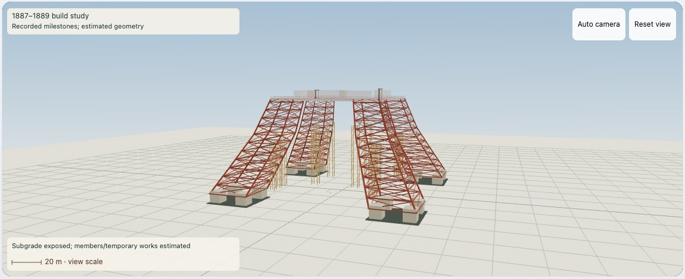
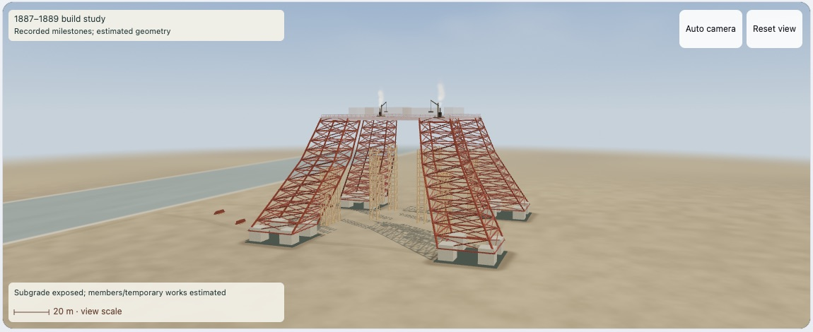
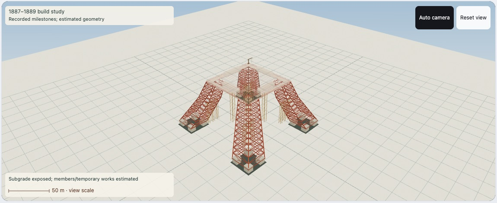
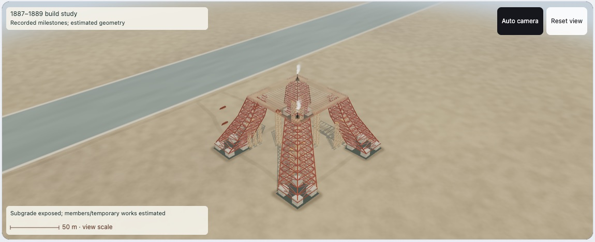
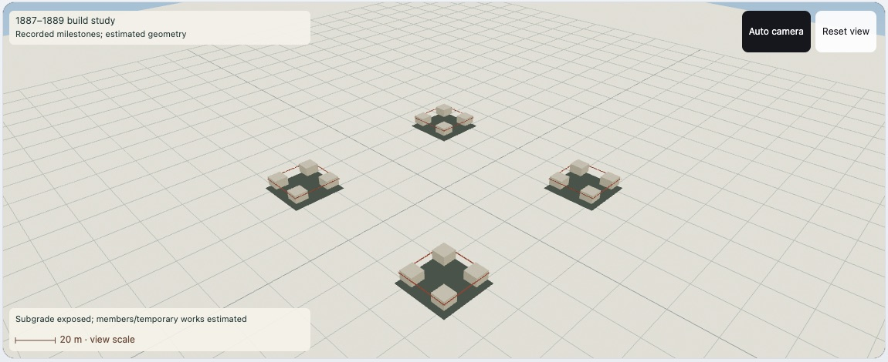
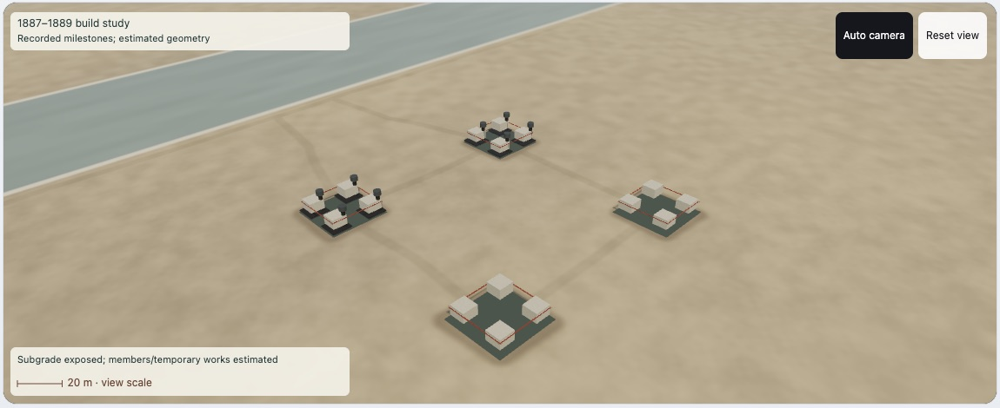
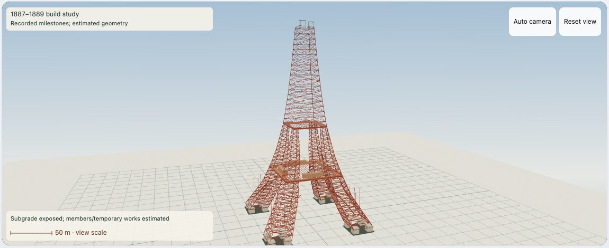
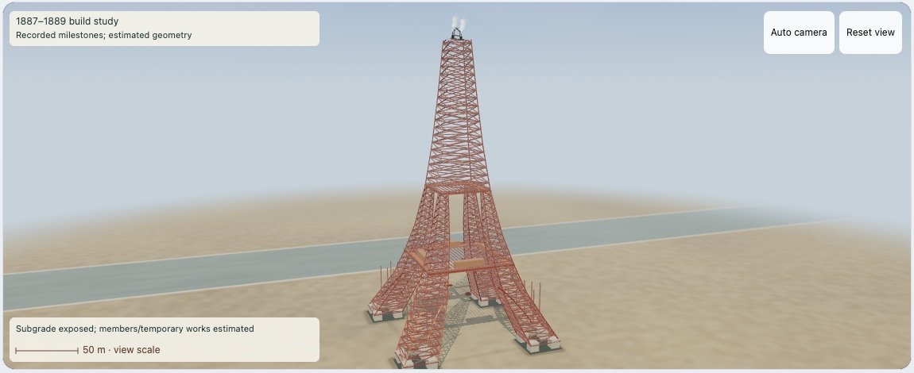
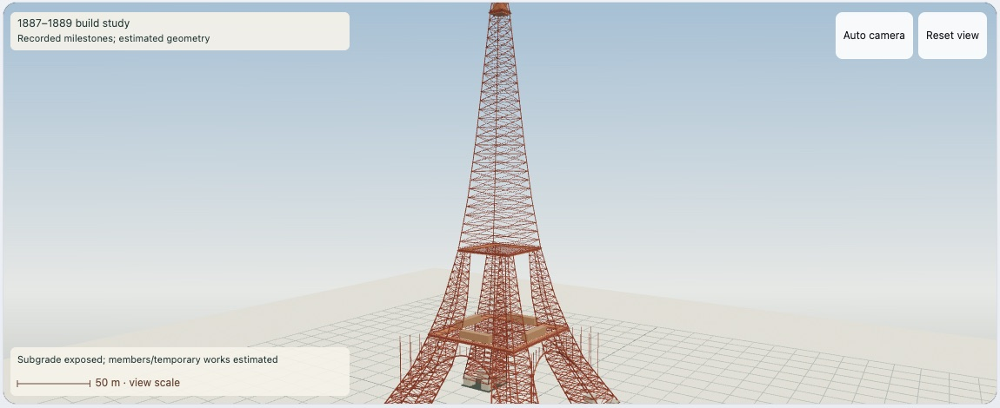
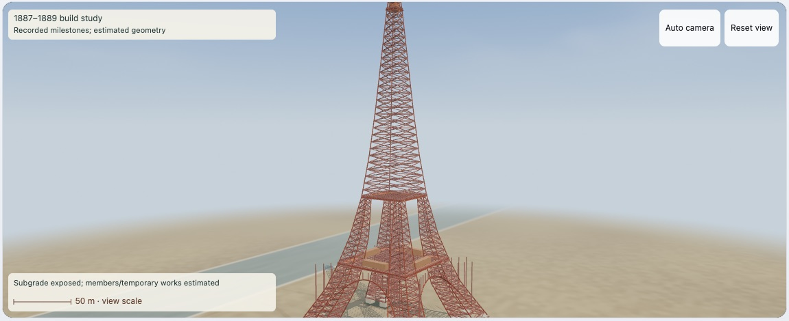

# Eiffel Tower construction art pass — 2026-11-16

Status: **passed** for the scoped local review. This is an agent review on one Mac. It is not a surveyed-geometry check, a native-speaker check, or a test on a real phone. Not yet pushed or deployed.

## Why Eiffel first

Fixed-camera captures of the six remaining Elapse timelines (t = 15/45/75/100, 1280×860, hardware GPU) showed the largest gap here. The tower stood on a flat sand-coloured plane with a grid, under a flat sky, with no shadows. The scaffolds read as thin sticks and the cranes as generic boxes. Notre-Dame came next (flat plane, plain stone). Titanic, Britannic, Sampoong and Seongsu already had water, smoke or city context, so the expected gain there was smaller. The construction story also fits the project's focus on the work people did.

## What changed

| Area | Change | Basis |
|---|---|---|
| Sky / haze / fog | Authored sky dome with soft clouds and a warm sun-side glow; FogExp2 haze matched to the horizon | Authored |
| Ground | Procedural compacted-earth worksite: excavation pads at the four foundations, worn haul paths, plane edge dissolving into haze, derivative-filtered (no shimmer) | Authored |
| River strip | Illustrative Seine-side strip and quay on the +y side | Direction from the SETE caisson note; distance and width **not surveyed** |
| Iron | Per-member tone variation, filtered speckle, sub-pixel widening to about 0.9 px with a haze-tinted tone for distant lattice (anti-moiré) | Authored |
| Shadows | Lattice, scaffolds, cranes and stacks cast shadows. `clipShadows` keeps unbuilt members from casting. Platforms cast only once complete. | Rendering fix: transparent lattice was previously excluded from shadows |
| Scaffolds | Ledgers every 2.5 m, top decks and sole plates on the existing towers | **Sourced:** 12 × 30 m + 4 × 40 m (SETE). Timber dimensions estimated |
| Cranes | Steam creeper cranes (boiler, stack, mast, jib, load) on the leg centre line / shaft, with steam that depends only on time | **Sourced:** small steam cranes climbing the elevator runners. Form, count and path estimated |
| Prefabricated sections | Stacks of 5 m sections near the haul path, chapters 2–5 | **Sourced:** ~5 m sections from Levallois-Perret. Counts and positions estimated |
| Caissons | Steel caissons and airlocks on the two Seine-side pillars, foundation chapter only | **Sourced:** compressed-air caissons on the Seine side. Shape and count estimated |

Unchanged: model JSON, dates, events, height keys, records (5), facts, sources, camera framing, inspection stops, gauges and text. `?art=0` renders the previous presentation from the same page. Blueprint mode turns off sky, fog, ground patterns and iron effects, and shows the grid as the scale cue (the grid was previously shown only in colour mode).

## Same-camera comparison

Same build, same URL parameters, same headless Chrome (ANGLE Metal, AMD Radeon Pro 5300), 1280×860, stage cropped. *Before* = packaged main `88baf3c`; *after* = this change.

| # | View | Before | After |
|---|---|---|---|
| 1 | Representative: Dec 1887 first-level joining, low angle (`t=40&yaw=200&pitch=6`) |  |  |
| 2 | Same moment, auto camera (`t=40`) |  |  |
| 3 | Foundations, caissons (`t=8`) |  |  |
| 4 | Upper shaft, Jan 1889 (`t=85&yaw=250&pitch=10`) |  |  |
| 5 | Completed, ground level (`t=100&yaw=215&pitch=4&zoom=0.8`) |  |  |

Review iterations (all same camera): the first Fable output was greyer and lower in contrast than the original blue sky at view 5, so the zenith gradient, fog density and ground tone were retuned. The first integration also had no lattice shadows. Remaining weaknesses: the stacks read as small red bars at overview distance, and the ground still looks fairly even from straight above.

## Checks run (2026-11-16)

| Check | Result |
|---|---|
| Elapse unit tests (UTC + Asia/Seoul) | 165/165 each (4 new: sourced scaffold counts, deterministic crane emitters, finite site geometry, provenance and no wall-clock animation) |
| Shared tests / locale unit tests / shared sync | 8/8, 3/3, up to date |
| Gate 1 `check_model` | PASS, 0 errors / 0 warnings |
| Gate 2 `shoot.mjs` (hardware) | **PASS, 50 shots**: all chapters, events, colour/blueprint, 4 angles, 5 languages, phone, tablet, 4 speeds |
| Building check (375/768/1440, both styles, 7 dates, all stops, date restore, disabled unbuilt stops) | 60/60 old and new. The repo script needs `?view=scene` since records became the default view; a local copy with only that change was used. |
| Records / topic check | 79/79, 0 issues |
| Five languages × 375/768/1440 | Eiffel 15/15; the other 10 rebuilt Elapse pages 150/150; 0 issues (includes console errors) |
| Rebuilt pages | 11 pages rebuilt; outside the import map they are byte-identical. Only `building-render.js`, `ui.js`, `opera-study.js` (a trailing newline that was already stale) and the 3 new modules differ |

### Playback (headless Chrome, hardware GPU, DPR 2, 10 s at normal speed)

| Case | Samples | Median | P95 | >50 ms | Draw calls |
|---|---:|---:|---:|---:|---:|
| 1440 desktop, t 20→53, art pass | 590 | 16.7 ms | 16.7 ms | 0 | 52 |
| 1440 desktop, t 20→53, `art=0` | 590 | 16.7 ms | 16.7 ms | 0 | 43 |
| 1440 desktop, t 70→100, art pass | 590 | 16.7 ms | 16.7 ms | 0 | 45 |
| 768 tablet emulation, art pass | 590 | 16.7 ms | 16.8 ms | 0 | 52 |
| 375 phone emulation (lightweight Phong, no shadow map), art pass | 591 | 16.7 ms | 16.7 ms | 0 | 52 |
| 375 phone emulation, `art=0` | 590 | 16.7 ms | 16.8 ms | 0 | 43 |

Intervals are capped at the 60 Hz frame rate, so they show no dropped frames but not how much GPU time is left over. Phone and tablet rows use desktop-GPU emulation. **Unverified:** physical iOS/Android GPUs, thermal throttling, cold network loads, Windows/Linux browsers, and the in-app browser pane (hidden during this session, so it was not measured).

## Facts, sources and people records

The Eiffel model JSON and `research/records/eiffel-tower.json` are unchanged: 5 records (design team, workshop crews and riveters, construction, painting care, lift technicians), their numeric facts and sources. New visual elements tie to the facts listed in `elapse/research/eiffel-notes.md`, re-read from the SETE history page on 2026-11-16. No source images, scans or text were copied, and no people are depicted.

## Fable 5.2

One specification-only call plus one availability probe: **$1.499000 reported in total** (list-price estimate; invoice not checked). Details are in [fable-provenance.json](fable-provenance.json). No repository source, records, keys or personal data were sent.
