# Notre-Dame and Titanic art pass — 2026-11-16

Status: **passed** for the scoped local review (details below). Agent review on one Mac. This is not a surveyed geometry check, native-speaker check or real-phone test. Not pushed or deployed at the time of writing.

## Notre-Dame — what changed

| Area | Change | Basis |
|---|---|---|
| Setting | Parvis paving west of the portals; street on the north; gardens with trees east toward the island tip and along the south; quay and Seine around the south and east | **Sourced placement** (City of Paris page on the cathedral's surroundings, updated 2026-09-21), shown as in 2019–2024 and not the planned redesign. Sizes and positions are estimated. |
| Stone | Ashlar coursing (0.55 m courses, staggered joints), grime near the ground and streaks under ledges; the dated `clean` value lightens it during restoration | Authored |
| Roof | Lead standing seams, sheet variation, patina and oxidation streaks | Authored |
| Rebuilt timber | Separate fresh-oak material (grain, flecks, hewing facets) so the new frame reads differently from the pre-fire frame | Authored. Dated visibility is unchanged. |
| Sky / haze | Shared sky dome and fog from the Eiffel module; during the fire period the zenith blends toward grey | Authored |
| Blueprint | Flat ground, trees as outlines, stone/lead/oak effects off | — |

Unchanged: model JSON, events, chapters, inspection stops, records (5), sources, fire/smoke effects and camera framing. `?art=0` shows the previous look.

## Titanic — what changed

| Area | Change | Basis |
|---|---|---|
| Seabed | Dark sediment with filtered mottling, ripples and nodules; scour and berm tone under the resting hull sections; sparse rust-brown specks in the debris field | Authored. The two main pieces lying ~600 m apart is already sourced (s23). |
| Survey-light pools | Soft cool pools around the resting hull sections from 1912 onward, so the wreck reads | Authored convention: there is no daylight at ~3,800 m |
| Water column / fog | Background dome and deep fog colour blended in below ~1,200 m camera depth | Authored |
| Marine snow | Tiny (1–3 px) drifting particles, driven only by the timeline position | Authored |
| Wreck weathering | Vertical streaks and patches on Simple-view toon materials only (the detailed view already has its own rust surface) | Authored; follows the existing rust value |
| Playback fix | Ecology spotlights stay counted at intensity 0 instead of being hidden, so the seabed close-up no longer triggers a mid-playback shader recompile | Performance; appearance unchanged |

Unchanged: dates, poses, break interpretation, records (4), projections and sources. No people, remains or lifeboats. Britannic shares `render.js`; every change is gated to Titanic.

## Same-camera comparison

Same URL parameters, headless Chrome (ANGLE Metal, AMD Radeon Pro 5300), 1280×860, stage cropped. *Before* = packaged `472f37f`; *after* = this change.

| # | View | Before | After |
|---|---|---|---|
| ND1 | Representative: Dec 2023 spire under scaffold (`t=88&yaw=215&pitch=8`) | 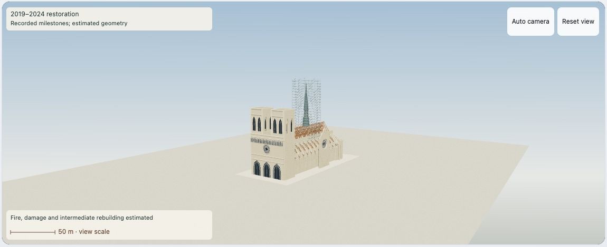 | 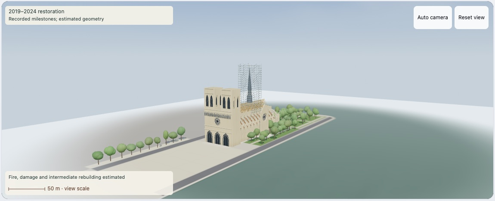 |
| ND2 | Restoration 2022 (`t=75`) | 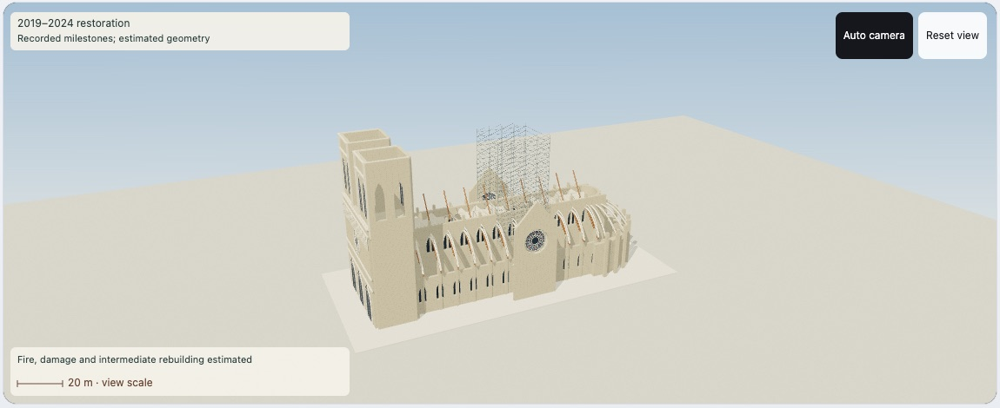 |  |
| ND3 | Reopened (`t=100&yaw=300&pitch=12`) | 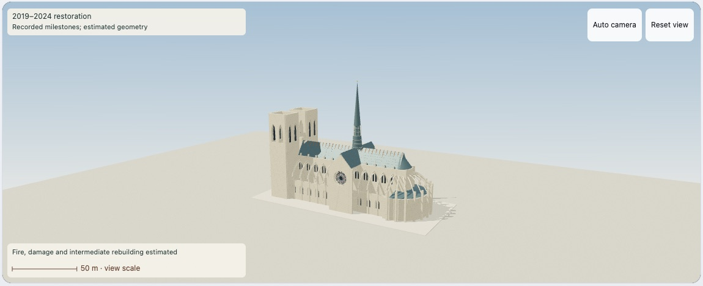 | 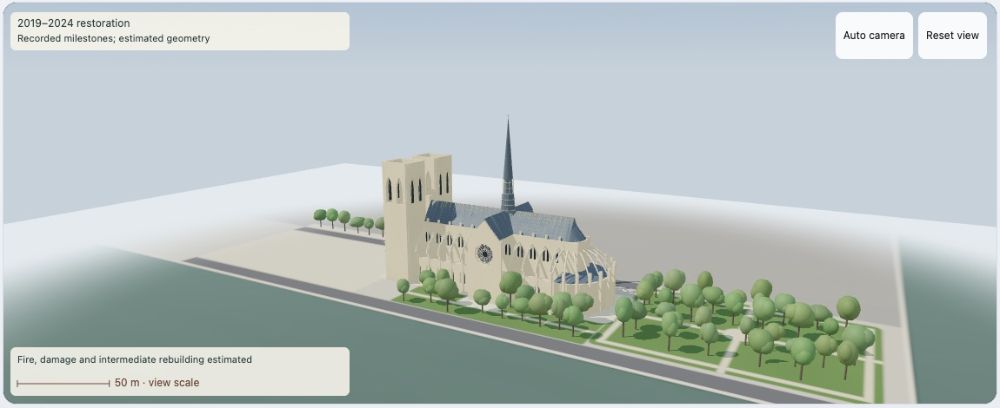 |
| ND4 | Before the fire (`t=5`) | 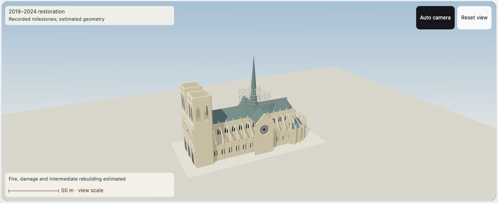 | 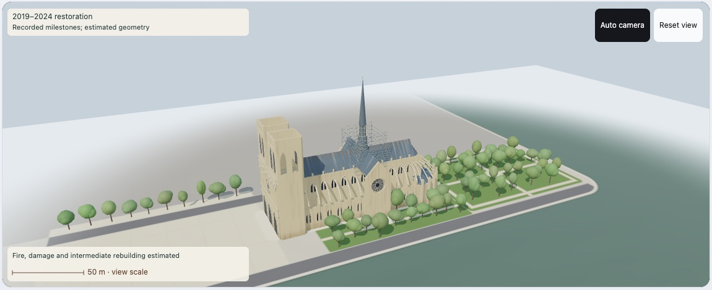 |
| ND5 | Securing, tarp (`t=50`) |  | 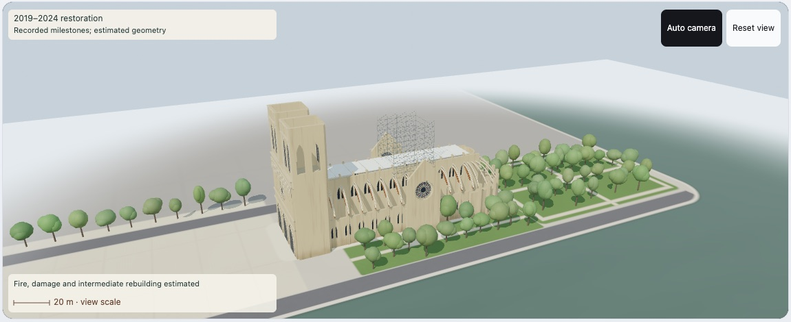 |
| TI1 | Representative: 1985 discovery era (`t=78`) | 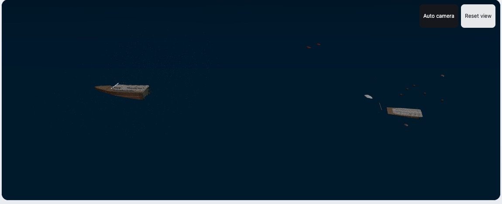 | 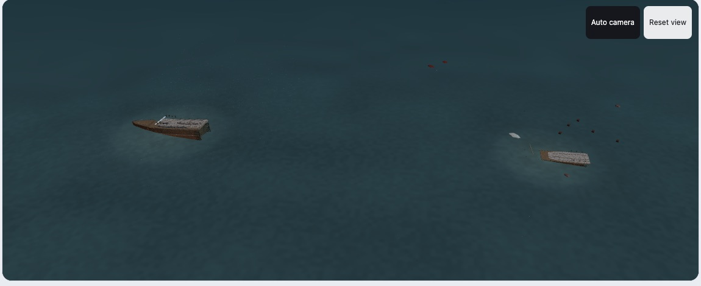 |
| TI2 | 2012 UNESCO protection era (`t=86`) | 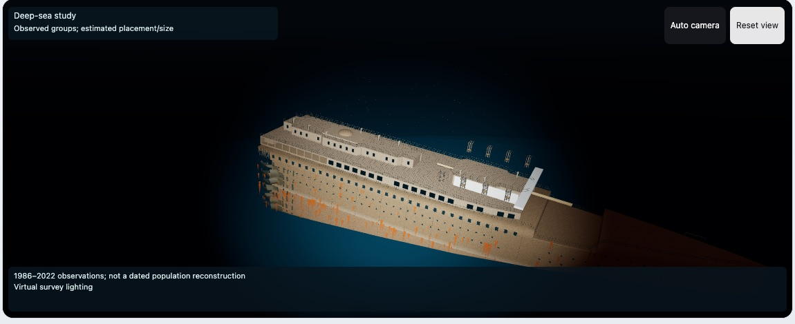 | 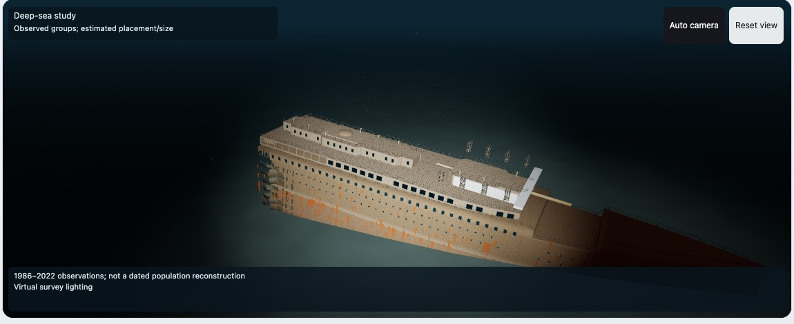 |
| TI3 | Just after landing (`t=60`) | 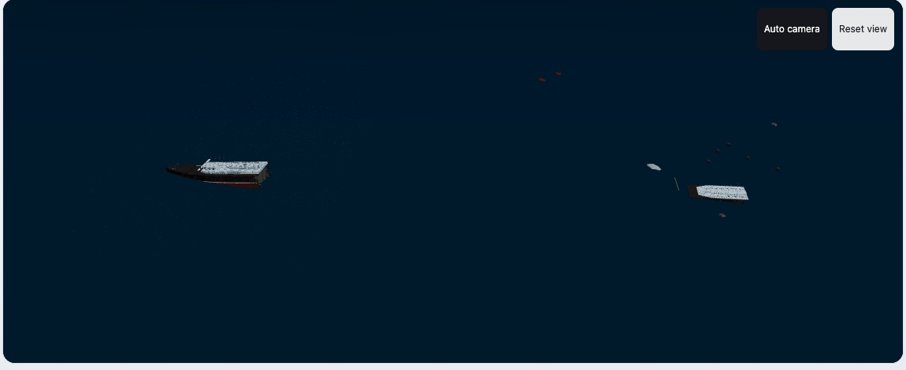 | 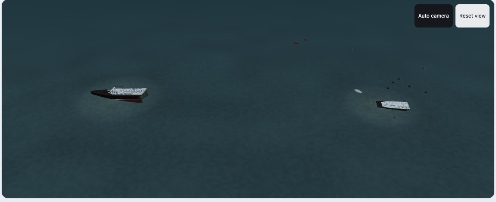 |
| TI4 | Projection (`t=95`) | 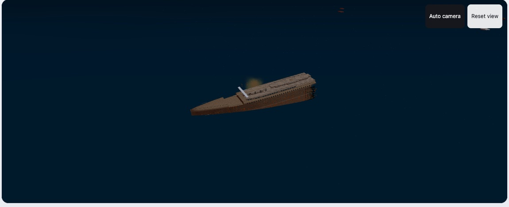 | 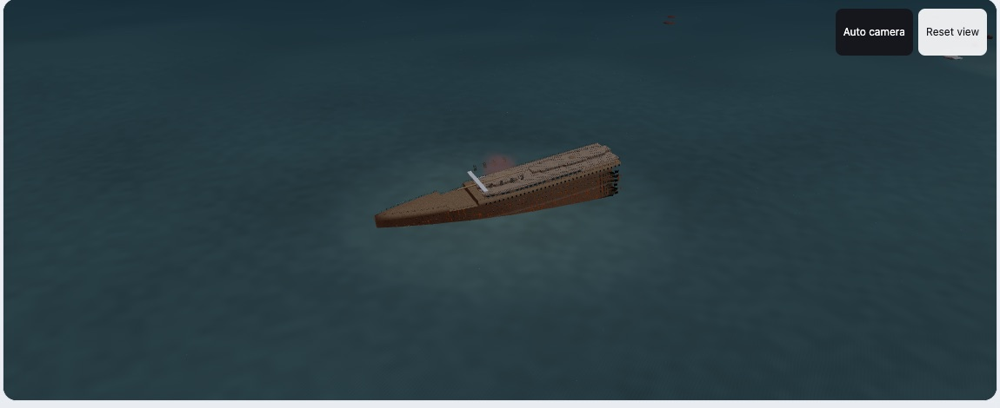 |
| TI5 | Bow inspection 2012 (`mode=explore&stop=bow`) | 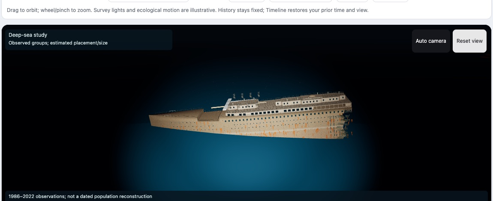 | 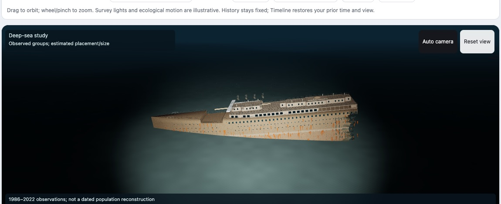 |

Review iterations: Notre-Dame first showed a hard pale ring at the ground edge, mint-pale trees and blown-out stone in close views; all three were retuned. A softer pale band remains at the far edge in wide views. Titanic's first sediment read as shallow tropical water and was darkened.

## Checks (2026-11-16/17)

| Check | Result |
|---|---|
| Elapse unit tests (UTC + Asia/Seoul) | 169/169 each (4 new) |
| Gate 2 `shoot.mjs` (hardware) | Notre-Dame QA build 54/54; Titanic QA build 97/97; Britannic quick 15/15; final packaged pages: see below |
| Notre-Dame structural check (375/768/1440, damage, restoration, 7 stops) | 117/117 on old and new pages (a local copy that only adds `?view=scene`) |
| Titanic ecology check | Fails identically on the **original** page and the new one ("historical card not restored"): an existing issue, recorded as a follow-up |
| Rebuilt pages | 11 pages; outside the import map byte-identical; only `notredame-render.js`, `render.js`, `deep-ecology.js` and 3 new modules differ |
| Final regression (packaged pages) | Titanic Gate 2 97/97, Notre-Dame Gate 2 54/54, exploration (Titanic + Britannic, 3 widths) 36/36, records reader Notre-Dame 79/79 and Titanic 64/64, five languages × 375/768/1440 across all 16 packaged demos (Unfold included) 240/240 with 0 issues |

### Playback (headless Chrome, hardware GPU, DPR 2, 10 s at normal speed)

| Case | Median | P95 | >50 ms frames |
|---|---:|---:|---:|
| Notre-Dame 1440, t 55→88, art / `art=0` | 16.7 / 16.7 ms | 16.8 / 16.7 ms | 0 / 0 |
| Notre-Dame 375 phone emulation, art | 16.7 ms | 16.7 ms | 0 |
| Notre-Dame 1440, fire t 10→34, art | 16.7 ms | 16.7 ms | 0 |
| Titanic 1440, t 60→88, art (6 runs after fix) | 16.7 ms | 16.7–16.8 ms | 1–2 per run, worst 83–100 ms |
| Titanic 1440, t 60→88, `art=0` (after fix) | 16.7 ms | 16.8 ms | 0–1 per run, worst 67 ms |
| Titanic `art=0` before the fix (the original rendering path) | 16.7 ms | 16.7 ms | 1 per run, **183–283 ms** at t≈79 |
| Titanic 375 phone emulation, art (before the fix) | 16.7 ms | 16.8 ms | 1 (150 ms) |

Measured at the 60 Hz cap, so these show dropped frames but not spare GPU time. **Unverified:** real phones, thermal throttling, cold loads, other OS/browsers.

## Facts and records

All model JSON and records JSON are unchanged. New placement facts for Notre-Dame and the sourced/authored split are recorded in `elapse/research/notredame-notes.md`; Titanic's are in `elapse/research/titanic-notes.md`. No source images, scans or text were copied.

## Fable 5.2

Two specification-only calls: Notre-Dame $1.939136 and Titanic $1.339856, **$3.278992 reported**. The session total, including the earlier Eiffel call and probe, is $4.777992 at list-price equivalent. On the current Max plan with extra usage off, this most likely came from plan usage rather than charges. See [fable-provenance.json](fable-provenance.json).
