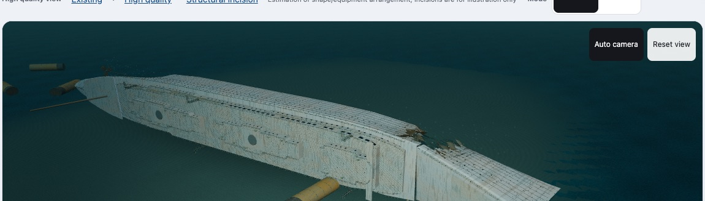
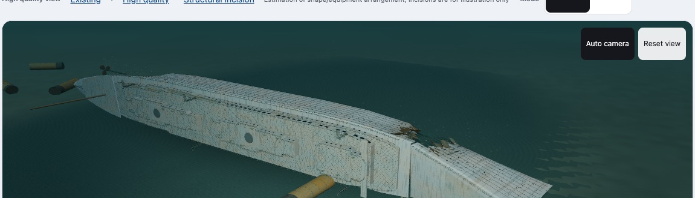
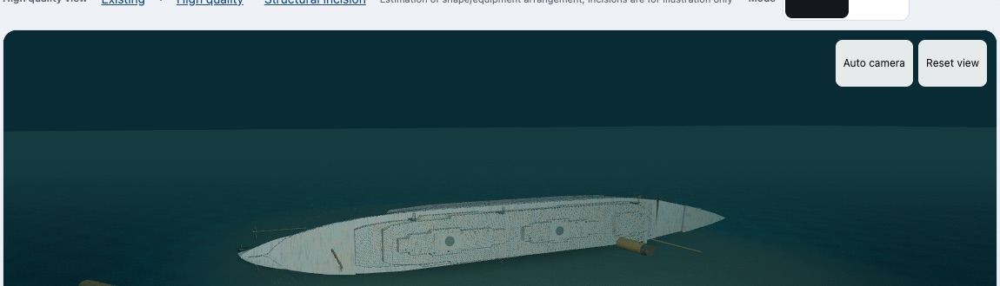
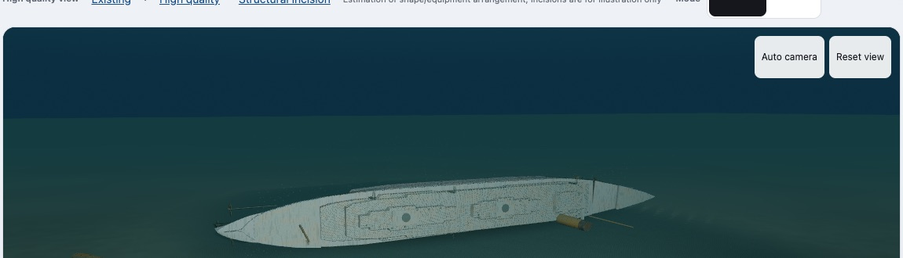
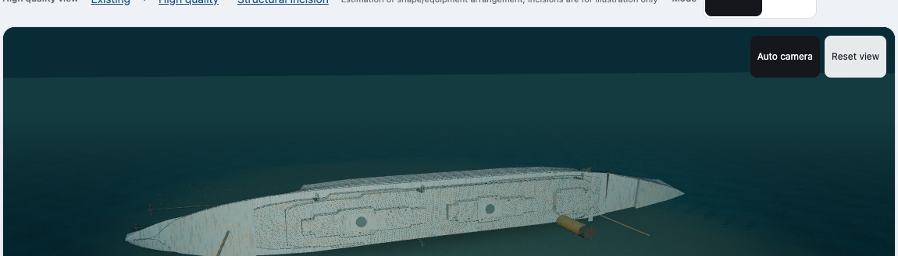
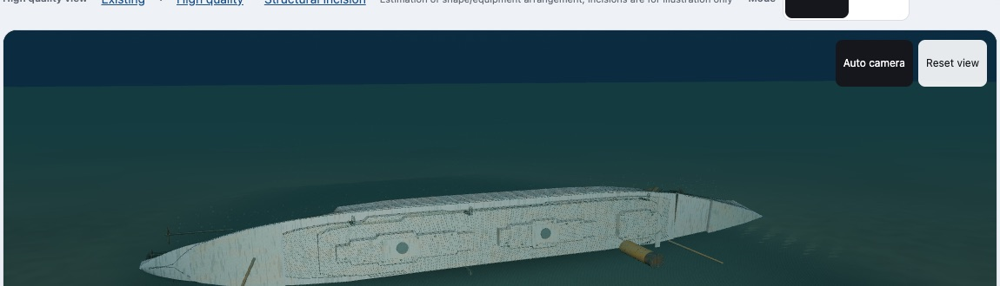
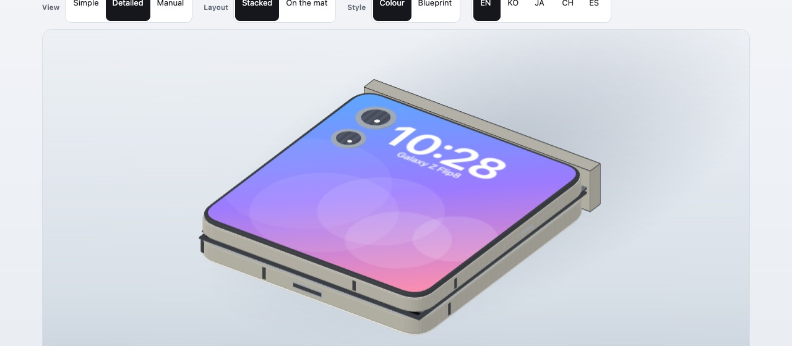
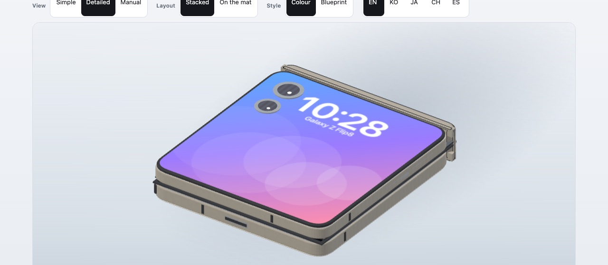
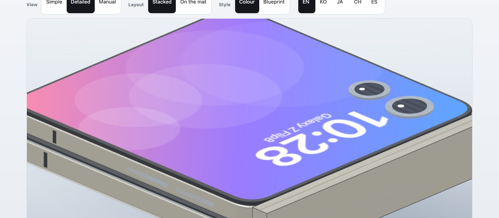
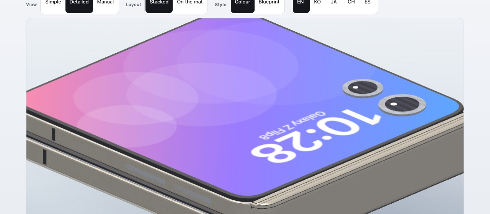

# 브리태닉 해저 패스 · Unfold 사실 정정 · 등판 형상 · 공통 재질 — 2026-11-17

상태: 로컬 범위 검수 **통과**. 한 대의 Mac에서 에이전트가 수행한 검수이며, 실측 형상이나 원어민 교정, 실제 휴대폰 검증이 아닙니다.

## 1. 브리태닉 (후보 5)

- 타이타닉용 해저 모듈을 **대륙붕(shelf) 설정**으로 재사용했습니다. 새 Fable 호출은 없습니다.
- 바뀐 것: 녹회색 퇴적물과 쓸림 자국, 청록색 수층, 대륙붕 색 안개, 마린 스노.
- 넣지 않은 것: 조사 조명 풀. 수심 약 120m는 희미한 햇빛이 닿는 깊이라서 제외했습니다.
- 선체 모델, 성장물(crust), 기록, 날짜는 바꾸지 않았습니다.
- **개선 폭은 작습니다.** 기존 화면에 이미 모래 질감과 수면광이 있었기 때문입니다.

| 화면 | 이전 | 이후 |
|---|---|---|
| 1996 상공 (`t=85`) |  |  |
| 2022 낮은 시점 (`t=98&yaw=150&pitch=10`) |  |  |
| 착저 직후 (`t=66`) |  |  |

## 2. Unfold 사실 정정과 형상 결함 (후보 6)

**폴드8 배터리 접근 방향**
- iFixit 원문(s5, 2026-08-13)을 2026-11-17에 다시 확인했습니다.
- 원문 요지: 두 셀은 서로 다른 반쪽에 있고, **그중 하나에** 접근하려면 바깥 화면을 거쳐야 한다. 후면 덮개는 분리가 어렵지 않다.
- 따라서 B 셀은 커버 화면 쪽, A 셀은 후면 유리 쪽에서 꺼내는 현재 모델과 일치합니다. 이전에 "충돌"로 표기한 것은 원문을 잘못 읽은 것이었습니다.
- 5개 언어 한계 문구, 배터리 메모, `DEMOS.md`를 정정했습니다.
- A쪽 분해 순서는 s5가 단계별로 설명하지 않으므로 여전히 추정입니다.
- 모델의 부품, 좌표, 단계는 바꾸지 않았습니다.

**플립8 힌지 돌출**
- 원인: 접힌 끝의 등판(spine)이 **각진 직육면체**여서, 본체의 둥근 모서리(r≈7mm) 밖으로 각진 덩어리처럼 튀어나와 보였습니다.
- 기하 계산으로는 모든 부품이 공식 접힘 치수(75.4 × 85.7 × 13.1mm) 안에 있습니다.
- 수정: 바깥쪽 모서리를 둥글게 하고 z 방향 가장자리에 베벨을 준 형상으로 바꿨습니다. 길이, 폭, 두께 범위는 유지합니다(단위 테스트로 확인).
- 같은 렌더러를 쓰는 폴드8과 아이폰 Duo에도 함께 적용됩니다.
- 모서리 반경은 추정 마감이며, 실측 힌지 커버 형상이 아닙니다.

| 화면 | 이전 | 이후 |
|---|---|---|
| 접힘 (`t=0`) |  |  |
| 완성 근접 (`t=100&yaw=135&pitch=25&zoom=1.6`) |  |  |

## 3. Unfold 공통 재질 패스 (후보 7)

- Fable 5.2 명세 전용 모듈 `unfold-art-pass.js`를 넣었습니다.
  - 재질: 알루미늄(비드블라스트·결), 강철, 유리 가장자리 반사, 기판 배선 격자·비아·실크 윤곽(글자 없음), 칩 상면, 배터리 포일 주름, 플렉스 케이블 배선, 구리
  - 조명: 중립 스튜디오 환경 이미지, 조정한 키 조명과 림 조명
  - `?art=0`이면 이전 표현이 나옵니다.
- **정직한 평가: 기본 배율에서는 효과가 미미합니다.** 미세 무늬는 픽셀보다 작아지면 흐려지도록 설계되어 있어, 확대했을 때만 보입니다.

| S24 분해 중 7배 확대 (`t=48&zoom=7`) | 이전 | 이후 |
|---|---|---|
| 플렉스 케이블·기판 가장자리 |  |  |

- **보류: 분해 단계 프레이밍.** 현재 카메라는 타임라인 내내 시점이 흔들리지 않도록 전체 분해 범위를 한 번에 맞춥니다. 단계별 확대로 바꾸면 시점이 움직이고 Gate 2 화면 구성 검사에도 영향이 커서, 이번에는 바꾸지 않았습니다. 기본 화면의 체감 개선이 필요하다면 다음 단계로 남깁니다.

## 검사

| 검사 | 결과 |
|---|---|
| Elapse 단위 테스트 (UTC·서울) | 169/169 |
| Unfold 단위 테스트 | 46/46 (신규 3: 등판 범위, 재질 체인·키, 출처) |
| Unfold Gate 1 (5개 기기) | 모두 PASS, 0 오류 / 0 경고. 폴드8·플립8은 공식 펼침·접힘 치수 포함 |
| Unfold 5개 언어 필드 (폴드8) | 123필드 PASS |
| 재빌드 범위 | Elapse 11개는 `render.js`·`titanic-deep-art.js`만 다름. Unfold 5개는 `render.js`·`ui.js`·새 모듈만 다르고, 폴드8은 정정한 모델 데이터도 다름 |
| 최종 회귀 | Unfold Gate 2 S24 53/53 · 아이폰17 Pro 53/53 · Duo 58/58 · 폴드8 58/58 · 플립8 58/58, 브리태닉 Gate 2 73/73, 타이타닉 빠른 Gate 2 21/21, 탐사 36/36, 브리태닉 기록 64/64, 16개 데모 5개 언어 × 3폭 240/240 (문제 0) |

## 재생 성능 (헤드리스 Chrome, AMD Radeon Pro 5300, DPR 2, 10초 재생)

| 측정 | 중앙값 | p95 | 50ms 초과 |
|---|---:|---:|---:|
| Unfold S24 1440, 아트 / `art=0` | 16.7 / 16.7ms | 16.8 / 16.7ms | 0 / 0 |
| Unfold 플립8 1440, 아트 / `art=0` | 16.7 / 16.7ms | 16.8 / 16.7ms | 1(67ms) / 0 |
| Unfold 플립8 375 휴대폰 에뮬레이션 | 16.7ms | 16.8ms | 0 |
| 브리태닉 1440, 아트 / `art=0` | 16.7 / 16.7ms | 16.7 / 16.7ms | 0 / 0 (둘 다 시작 직후 83ms 1회) |

60Hz 상한 측정이라 프레임 누락은 보여 주지만 GPU 여유는 보여 주지 않습니다. 실제 휴대폰, 발열, 콜드 로드는 미검증입니다.

## 비용

Fable 5.2 호출 1회(Unfold): **$1.505408** (정가 환산). 세션 누적은 $6.283400입니다. Max 요금제이고 추가 사용량이 꺼져 있어 요금제 사용량에서 차감되었을 가능성이 높습니다. 자세한 내용은 [fable-provenance.json](fable-provenance.json)에 있습니다.
