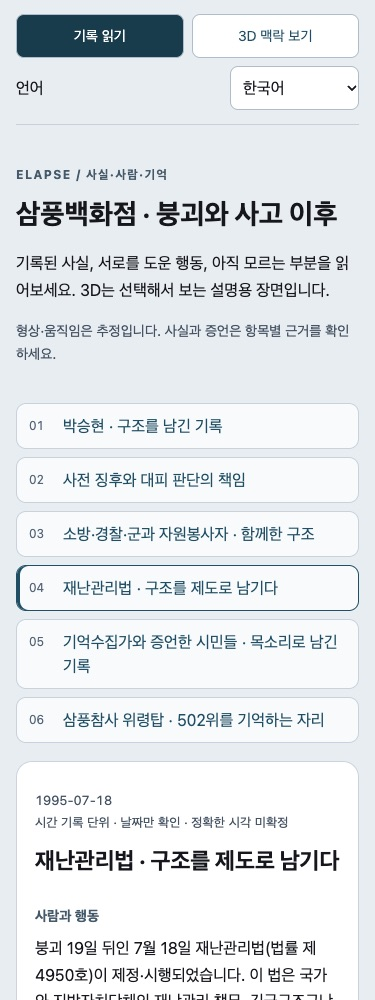
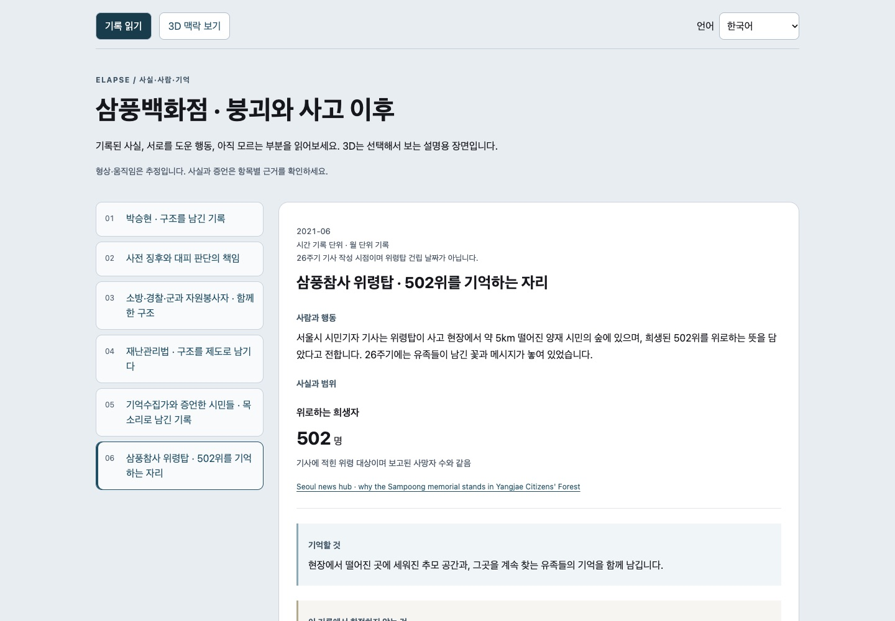
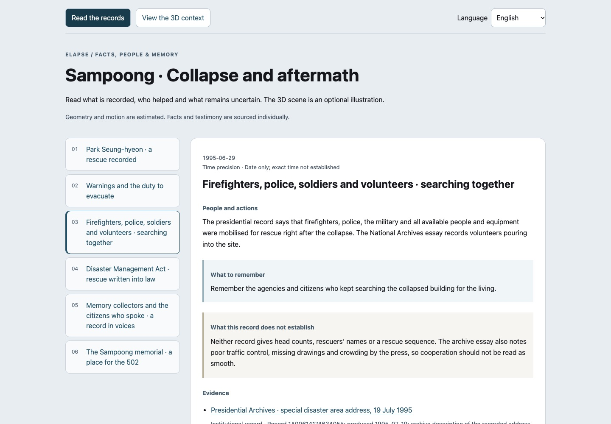

# 삼풍백화점 기록·추모 점검 — 2026-11-17

상태: 로컬 범위 검수 **통과**. 한 대의 Mac에서 에이전트가 수행한 검수입니다. 원어민 교정이나 유족·생존자 단체의 검토를 거친 것이 아닙니다.

## 방향

삼풍은 이미 3D 표현이 충분하므로, 이번에는 장면을 강화하지 않고 **기록과 추모**를 보강했습니다. 3D 장면, 형상, 타임라인 시각은 바꾸지 않았습니다. 사람은 여전히 묘사하지 않습니다.

## 출처 재확인 (2026-11-17, 브라우저로 원문 확인)

| 출처 | 확인한 내용 |
|---|---|
| [대통령기록관 1A00614174634055](https://www.pa.go.kr/research/contents/policy/index15.jsp?poMode=view&policySeq=3045) | 1995-07-19 **특별재해지역** 선포 담화 녹화 기록. 소방·경찰·군 등 인력·장비 동원, 재난관리법 마련과 그에 따른 선포 |
| [국가법령정보센터 · 재난관리법](https://www.law.go.kr/%EB%B2%95%EB%A0%B9/%EC%9E%AC%EB%82%9C%EA%B4%80%EB%A6%AC%EB%B2%95/(04950,19950718)) | 법률 제4950호, 1995-07-18 제정·시행. 제3조(책무), 제20~23조(긴급구조구난본부, 현장지휘가 구조기관·자원봉사자에게 임무 부여), 제30~32조(특별재해지역) |
| [국가기록원 주제해설](https://www.archives.go.kr/next/newsearch/listSubjectDescription.do?id=001042&sitePage=) | 08:05경 균열, 대피 조치 부재, 자원봉사자 쇄도, 교통 통제·도면 정보 부족·과열 취재, 7월 18일 재난관리법. 집필자 해설이며 기관 공식 입장 아님 |
| [서울시 문화 소식 50141](https://news.seoul.go.kr/culture/archives/50141) | 2014년 메모리인서울 프로젝트. 기억수집가 15명이 생존자·목격자·구조대 기억을 수집, 서울도서관·누리집 보관 계획 |
| [서울시 시민기자 기사 2002100](https://mediahub.seoul.go.kr/archives/2002100) | 2021-06-30. 위령탑은 현장에서 약 5km 떨어진 양재 시민의 숲, 502위를 위로하는 뜻, 26주기 유족의 꽃과 메시지. 서울시 공식 입장 아님 |
| [서울연구원 사진 기록](https://data.si.re.kr/node/52399) | 통합코드 01O01101Db8000, 1995년 6월, 서초동. 출처 제목의 깨진 글자 정정용 |

## 바뀐 점

**사실 정정**
- 7월 19일 사건의 용어를 '특별재난지역'에서 1995년 공식 용어인 **'특별재해지역'**으로 고쳤습니다. 5개 언어 모두 고쳤습니다(special disaster area · 特別災害地域 · 特别灾害地区 · zona especial de desastre). 설명에는 새 재난관리법에 따른 선포임을 덧붙였습니다.
- 서울연구원 출처 제목(`June1995 exterior record01O01101Db8000`)을 `June 1995 exterior photograph, code 01O01101Db8000`으로 고쳤습니다. 대표 장면 페이지의 참고문헌 표기도 함께 고쳤습니다.
- 연구 노트의 숫자 앞 띄어쓰기 오류 39곳을 고쳤습니다(예: `uses17:55`). URL은 건드리지 않았습니다.

**추모 기록: 2건에서 6건으로**

| 순서 | 기록 | 출처 | 장면 연결 |
|---|---|---|---|
| 01 | 박승현 · 구조를 남긴 기록 (기존, 기본 표시) | 대한민국사연표 | 마지막 생존자 구조 |
| 02 | 사전 징후와 대피 판단의 책임 (기존 기록을 정리) | 국가기록원 해설 | 이상 징후 |
| 03 | 소방·경찰·군과 자원봉사자 · 함께한 구조 (신규) | 대통령기록관 + 국가기록원 해설 | 구조·수습 |
| 04 | 재난관리법 · 구조를 제도로 남기다 (신규) | 국가법령정보센터 + 대통령기록관 | 특별재해지역 선포 |
| 05 | 기억수집가와 증언한 시민들 · 목소리로 남긴 기록 (신규) | 서울시 | 특별재해지역 선포(범위 밖임을 날짜 메모로 표시) |
| 06 | 삼풍참사 위령탑 · 502위를 기억하는 자리 (신규) | 서울시 시민기자 기사 | 같음 |

- 기존 '사전 징후·대피 판단·시민의 도움' 기록은 징후와 대피 책임만 다루도록 정리했습니다. 자원봉사자 내용은 새 구조 기록으로 옮겼습니다.
- 모든 새 기록에 "이 기록에서 확정하지 않는 것"을 적었습니다. 예를 들어 구조 기록은 인원수·구조자 이름·구조 순서를 담지 않으며 초기 혼선도 함께 적었고, 위령탑 기록은 건립 날짜를 확인하지 않았다고 밝혔습니다.
- 2014년과 2021년 날짜에는 1995년의 사건이 아니라는 메모를 붙였습니다.
- 서울시 기사에 나오는 개인 이름(생존자 외 인물)은 새로 넣지 않았습니다. 구술 내용도 옮기지 않았습니다.

| 휴대폰 폭 · 한국어 · 재난관리법 | 데스크톱 · 한국어 · 위령탑 |
|---|---|
|  |  |

## 검사

| 검사 | 결과 |
|---|---|
| Elapse 단위 테스트 | 171/171 |
| 기록·토목 테스트 (서울 시간대) | 21/21 |
| Gate 1 (삼풍) | PASS, 0 오류 / 0 경고 |
| 생성기 재현성 | 변경 전 생성기 실행 결과가 커밋된 JSON과 동일함을 확인한 뒤 수정. 성수대교 JSON은 바뀌지 않음 |
| 기록 화면 (8개 예제 × 3폭 × 5개 언어, 링크·초점·3D 복귀 포함) | 570건, 문제 0 |
| 삼풍 기록 화면 (5개 언어 × 3폭, 장면 연결 포함) | 94건, 문제 0 |
| 서울 토목 기록 검사 (삼풍·성수대교) | 41건 PASS |
| 삼풍 Gate 2 (하드웨어 GPU, 전체) | 47/47 |
| 대표 장면 페이지 | 93건 PASS, 콘솔 오류 0 |
| 16개 데모 5개 언어 × 3폭 | 240/240, 문제 0 |

3D 장면과 엔진은 바꾸지 않았으므로 재생 성능은 측정하지 않았습니다. 대표 장면 검사에서 중앙값 16.6ms, 50ms를 넘는 프레임 0회였습니다.

## 미검증

- 원어민 교정. 특히 새 기록의 일본어·중국어·스페인어 문장
- 유족·생존자 단체 등 당사자 관점의 검토
- 위령탑 건립 연도와 제막 경위(공식 출처 미확인)
- 메모리인서울 최종 인터뷰 인원과 출간물
- 실제 휴대폰과 태블릿

## 비용

Fable 호출 없음(추가 비용 $0). 세션 누적은 $6.283400(정가 환산) 그대로입니다.
