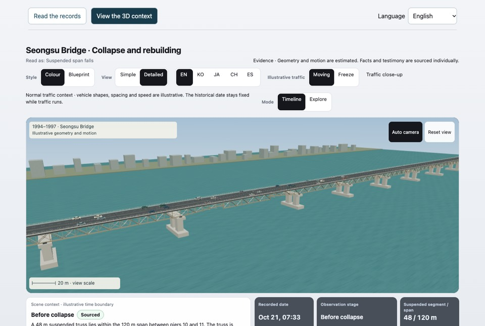
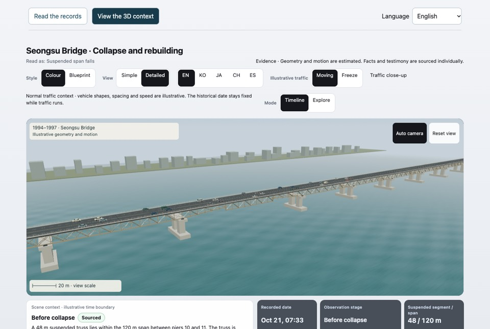
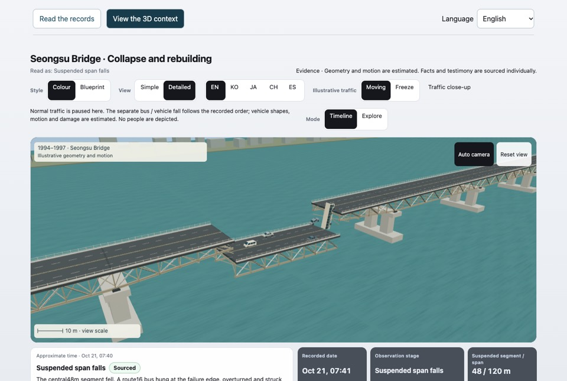
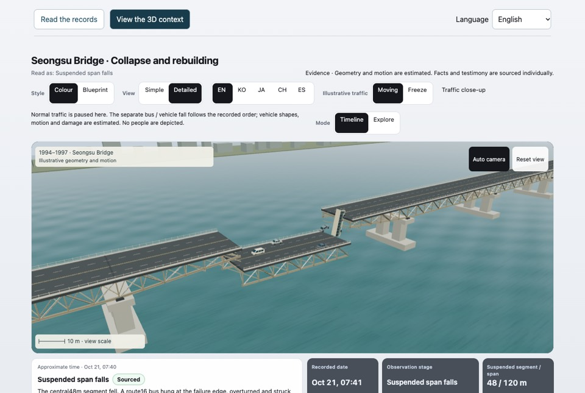
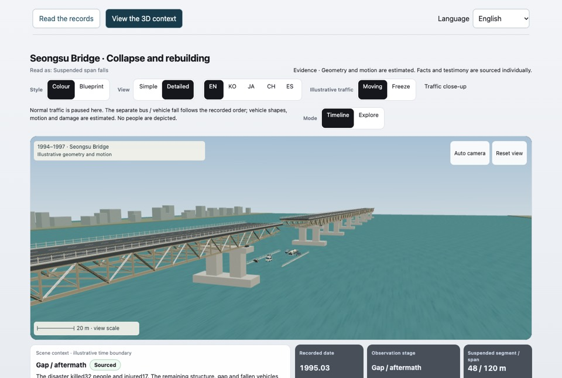
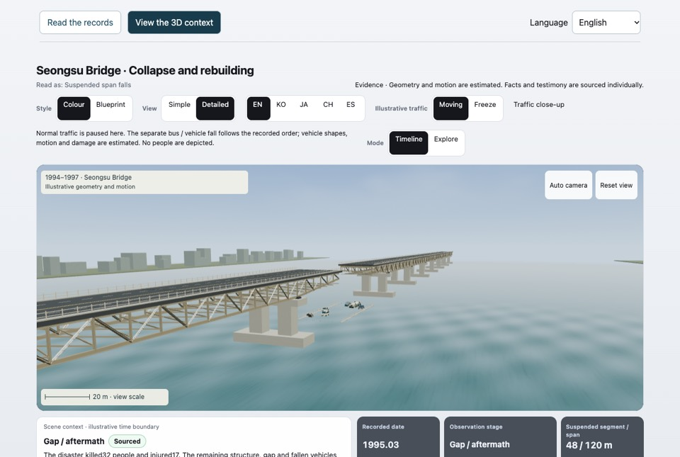
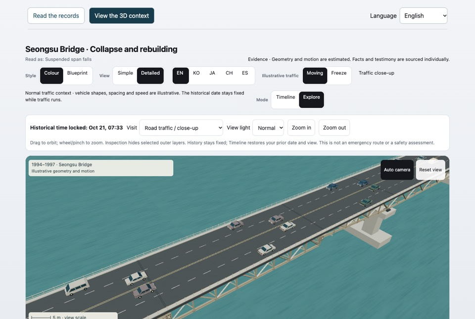
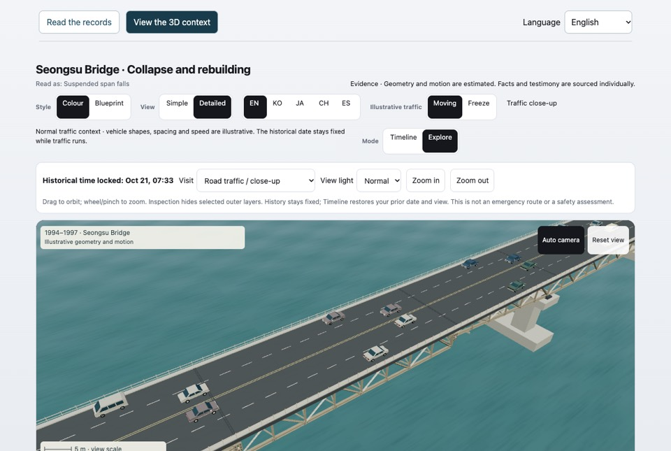

# 성수대교 강·하늘 표현 — 2026-11-17

상태: 로컬 범위 검수 **통과**. 한 대의 Mac에서 에이전트가 수행한 검수이며, 실제 휴대폰 검증이 아닙니다.

## 무엇이 바뀌었나

- **하늘과 안개:** 에펠·노트르담과 같은 흐린 낮 하늘 돔과 원근 안개를 성수대교 장면에 넣었습니다(모듈 재사용).
- **한강 수면:** 새 모듈 `seongsu-art-pass.js`를 썼습니다.
  - 가까운 물은 조금 더 깊은 청록으로 표현합니다.
  - 보는 각도에 따라 하늘을 반사합니다(Fresnel). 그래서 멀리 갈수록 물빛이 밝아지고, 낮은 시점에서는 하늘빛이 수면에 비칩니다.
  - 긴 물결은 픽셀보다 작아지기 전에 흐려지며, 타임라인 `t`를 따라 움직입니다.
  - 물 평면 가장자리는 안개 속으로 사라집니다.
- **바꾸지 않은 것:** 기존 물결 무늬와 다리·차량·사고 장면은 그대로입니다.
- **이전 표현과 도면:** `?art=0`이면 이전 표현이 나오며, 이전 페이지와 픽셀 단위로 같습니다. 도면 스타일도 이전과 같습니다.
- **삼풍:** 같은 렌더러를 쓰지만 바뀌지 않았습니다. 세 시점에서 픽셀 단위로 같습니다.
- **연출과 기록의 구분:** 날씨, 빛, 물빛, 건너편 건물 덩어리는 설명용 연출이며 1994년 10월 21일의 기록이 아닙니다. 연구 노트에 같은 구분을 적었습니다.
- **비용:** Fable 호출 없음(추가 $0).

## 같은 시점 비교 (1280×860)

| 화면 | 이전 | 이후 |
|---|---|---|
| 붕괴 전 (`t=5`) |  |  |
| 현수 구간 낙하 (`t=35`) |  |  |
| 사고 이후 낮은 시점 (`t=60&yaw=200&pitch=6`) |  |  |
| 탐사: 도로 통행 (`mode=explore&stop=traffic&t=5`) |  |  |

## 정직한 평가

- **기본 시점:** 평평한 청록 면이었던 강이 수평선 쪽으로 밝아져 깊이가 생겼고, 건너편 건물이 안개로 물러납니다.
- **낮은 시점:** 개선 폭이 가장 큽니다.
- **탐사 근접 화면:** 차이가 작습니다.
- **기본 카메라:** 하늘은 화면 위쪽에 좁게만 보입니다(카메라 구도는 바꾸지 않음).
- **남은 약점:** 건너편 건물은 여전히 단순한 상자이고, 가까운 물에 기존 줄무늬 질감이 남아 있습니다.

## 검사

| 검사 | 결과 |
|---|---|
| Elapse 단위 테스트 (UTC·서울) | 171/171 (신규 2: 셰이더 연결·캐시 키·끄기, 시계 미사용·출처 표기) |
| 성수대교 Gate 2 | 46/46 |
| 성수대교 통행 검사 | PASS 48 |
| 성수대교 기록 화면 | 34건, 문제 0 |
| 탐사 화면 (하드웨어 GPU) | 36/36 |
| 삼풍 Gate 2 빠른 검사 (하드웨어 GPU) | 14/14 |
| 16개 데모 5개 언어 × 3폭 | 240/240 |
| 다시 빌드한 페이지 11개 | 각 페이지의 내장 엔진 한 줄만 바뀜 |

소프트웨어 렌더링에서는 삼풍 재생 속도 검사와 탐사의 독립 시계 검사가 실패했습니다. 수정 전 원본 삼풍 페이지도 소프트웨어 렌더링에서 똑같이 실패하므로, 렌더링이 느려 생기는 기존 문제입니다. 하드웨어 GPU에서는 둘 다 통과합니다.

## 재생 성능 (헤드리스 Chrome, AMD Radeon Pro 5300, DPR 2, 재생)

| 측정 | 중앙값 | p95 | 50ms 초과 | 그리기 호출 |
|---|---:|---:|---:|---:|
| 1440 이후 / 이전 | 16.7 / 16.7ms | 16.7 / 16.8ms | 0 / 0 | 65 / 64 |
| 375 휴대폰 에뮬레이션 이후 / 이전 | 16.7 / 16.7ms | 16.8 / 16.8ms | 0 / 0 | 65 / 64 |

60Hz 상한 측정입니다. 실제 휴대폰, 발열, 콜드 로드는 미검증입니다.
