# Unfold 분해 단계 프레이밍 — 2026-11-17

상태: 로컬 범위 검수 **통과**. 한 대의 Mac에서 에이전트가 수행한 검수이며, 실제 휴대폰 검증이 아닙니다.

## 무엇이 바뀌었나

- **이전:** 자동 카메라가 타임라인 내내 전체 분해 범위(시작·끝 위치의 합집합)를 한 화면에 맞췄습니다. 재생 중에만 지금 부품 쪽으로 조금(1.35배) 다가갔고, 정지 화면이나 링크로 연 화면에서는 부품이 작게 보였습니다.
- **이후:** 자동 카메라가 **지금 단계**를 맞춥니다. 단계마다 상자를 하나 만듭니다.
  - 부품이 내려앉을 완성 기기 자리
  - 그 단계 부품의 시작 위치
  - 시작에서 제자리까지 가는 실제 궤적(16개 지점 샘플). 매트 레이아웃에서 부품이 들려 호를 그리는 구간도 들어갑니다.
- 시점은 `t`만으로 정해집니다. 정지 화면과 재생 화면, `?t=` 링크가 같은 구도를 보여 줍니다.
- 단계가 바뀔 때는 끊지 않고 이어 줍니다.
  - 넓어질 때는 다음 단계를 1.5 앞서 미리 엽니다.
  - 좁아질 때는 천천히 닫힙니다(시간 상수 2.5).
  - 마지막에 ±1.5 구간을 평균합니다.
  - 단위 테스트로 상자가 항상 지금 단계를 담는지 확인합니다.
- 맥락을 남기도록 전체 화면보다 2.4배 이상 다가가지 않고, 단계 상자에는 여백 8%를 더 줍니다.
- 시작(분해 전)과 끝(완성 기기로 돌아오는 장면)은 이전과 같습니다.
- **자동 카메라 끄기** 버튼이나 `?auto=0`을 쓰면 이전처럼 전체 분해 범위를 보여 줍니다. 켜고 끌 때는 부드럽게 바뀝니다.
- 드래그로 각도를 돌려도 자동 카메라가 꺼지지 않습니다. 이전에는 드래그하면 꺼졌는데, 이제 꺼지면 화면이 전체 범위로 물러나 오히려 어색하기 때문입니다.
- 인쇄용 조립 설명서 그림은 전체 범위 구도를 그대로 씁니다.

## 같은 시점 비교 (1280×860, 기본 각도)

| 화면 | 이전 | 이후 |
|---|---|---|
| S24 1단계 (`t=13`) | 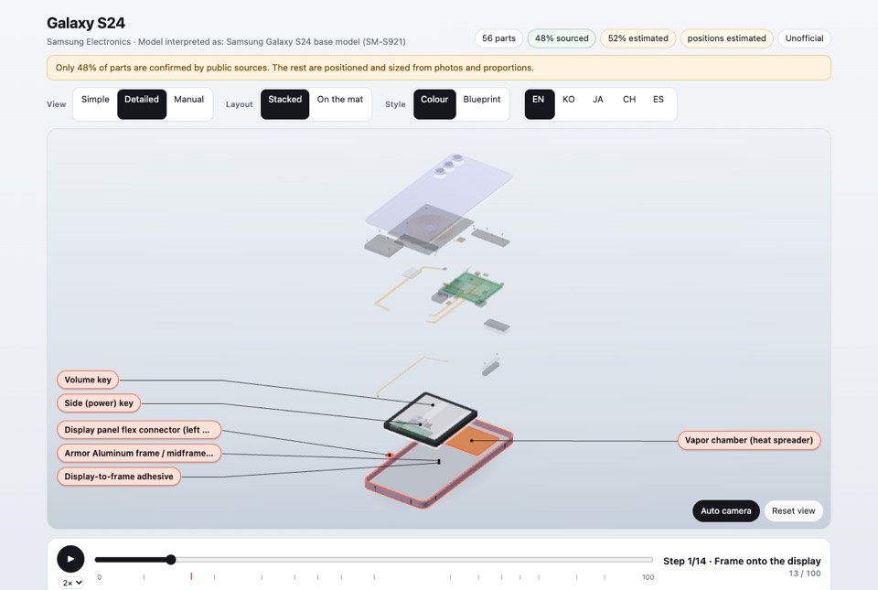 | 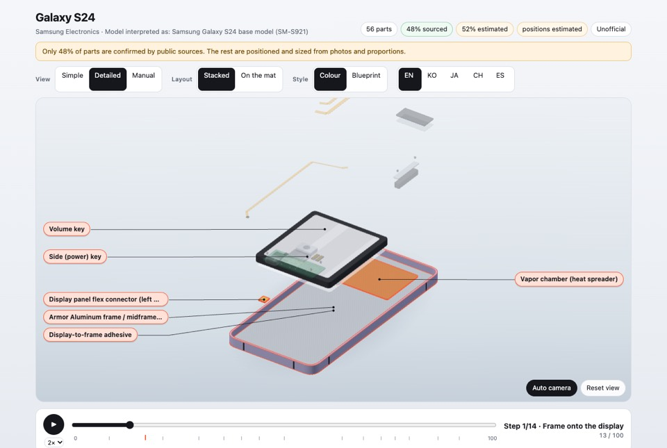 |
| S24 7단계 (`t=48`) | 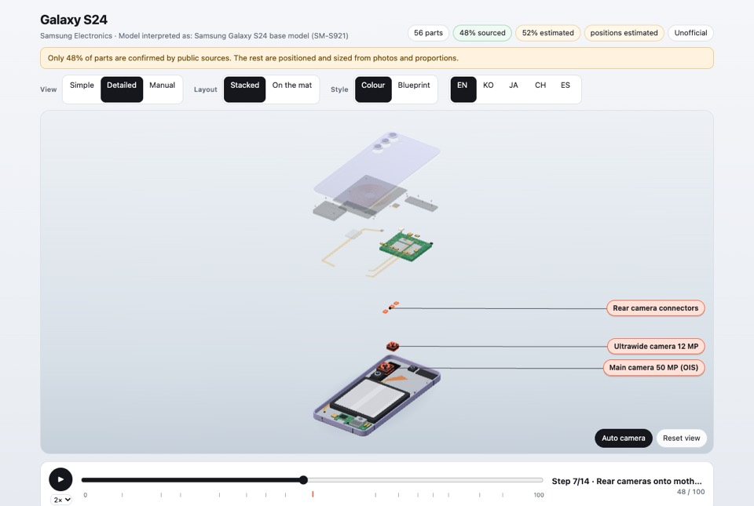 | 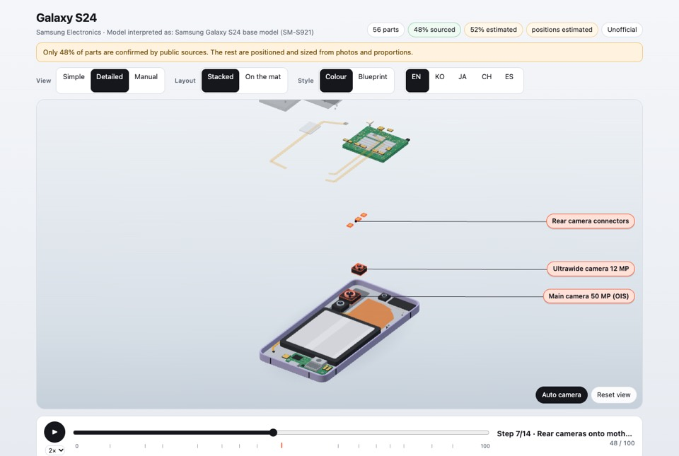 |
| 폴드8 4단계 (`t=30`) | 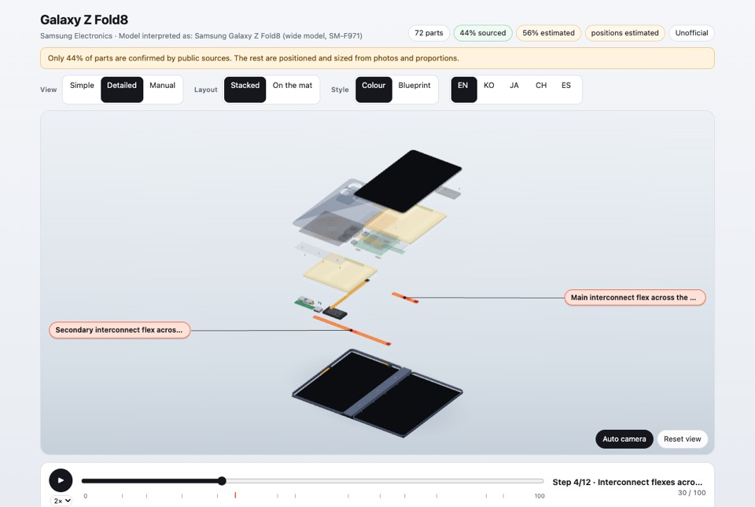 | 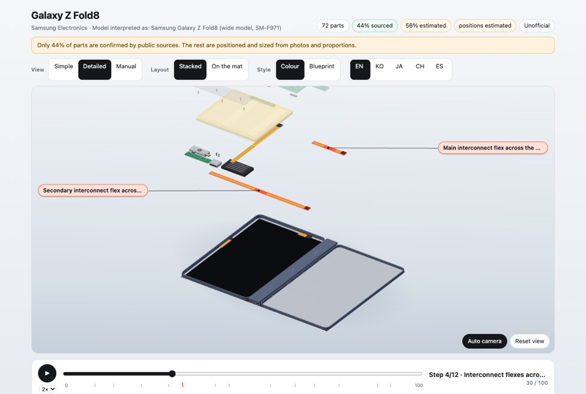 |
| 아이폰 Duo 6단계 (`t=48`) | 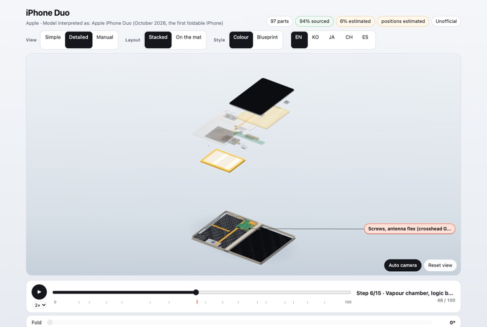 | 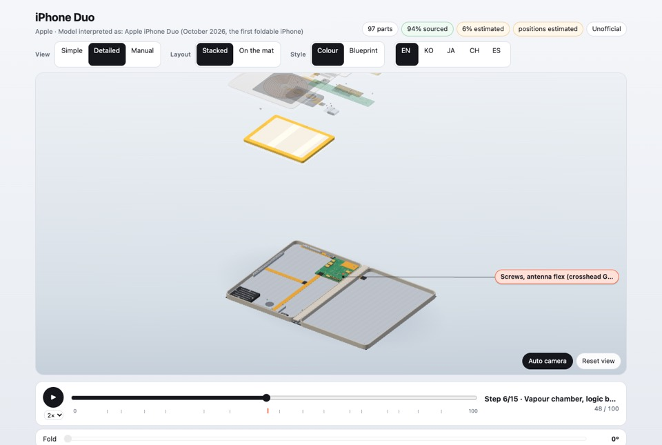 |
| S24 매트 (`t=48&layout=knoll`) | 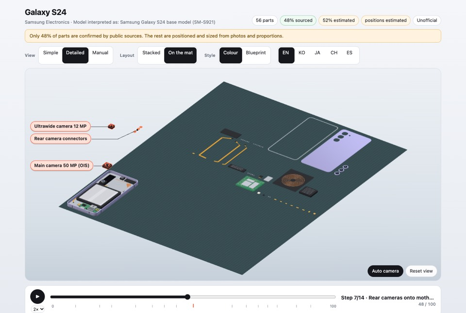 | 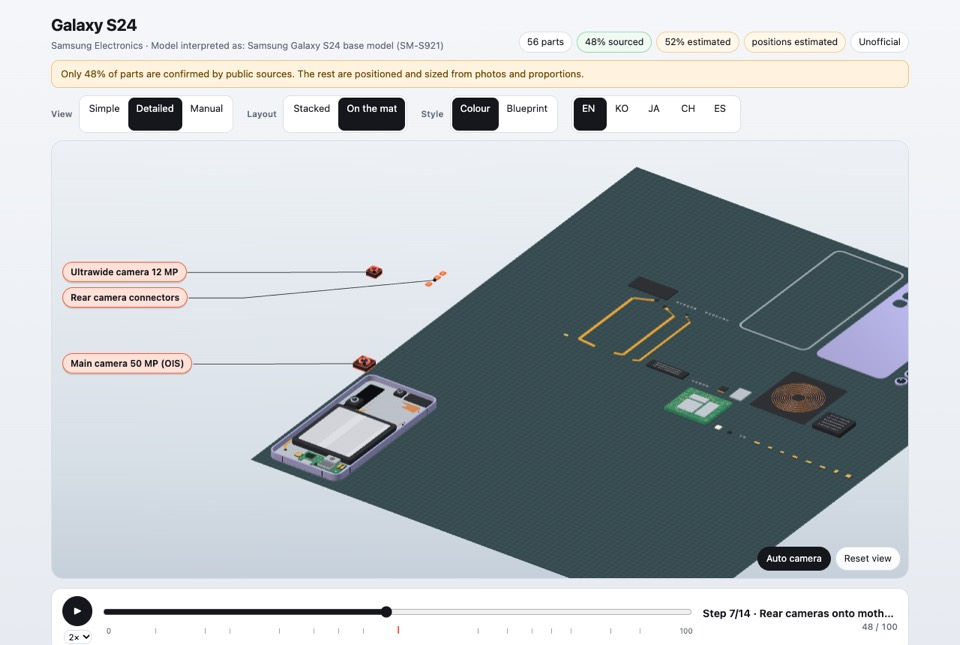 |

## 정직한 평가

- **쌓기(기본) 레이아웃:** 조립 중인 기기가 화면에서 약 1.5~1.8배 커졌습니다. 이번 단계 부품과 이름표가 함께 읽힙니다.
- **매트 레이아웃:** 변화가 작습니다. 부품이 매트 반대쪽에서 출발하는 단계가 많아, 그 단계 상자가 매트 대부분을 덮기 때문입니다.
- **잘림:** 위쪽에 대기 중인 부품(두 단계 이상 남아 유리처럼 흐리게 표시)은 화면 위로 잘릴 수 있습니다. 의도한 것입니다.
- **늦은 단계:** 위에서 내려오는 큰 부품(후면 유리 등)의 단계는 상자가 전체 범위와 비슷해 이전과 거의 같습니다.
- **움직임:** 재생 중 단계가 바뀔 때마다 카메라가 확대·축소합니다. 기본 2배속에서 한 단계는 약 1.8초입니다. 가장 빠른 확대는 0.1 구간당 약 2.3%(첫 단계 진입)이며, 화면 위치가 크게 튀는 프레임은 생기지 않았습니다. 다만 사람이 실제로 보고 어지러운지는 확인하지 않았습니다.

## 휴대폰 폭 (375px, 무대만)

| S24 `t=13` 이전 | 이후 | S24 `t=48` 이전 | 이후 |
|---|---|---|---|
| 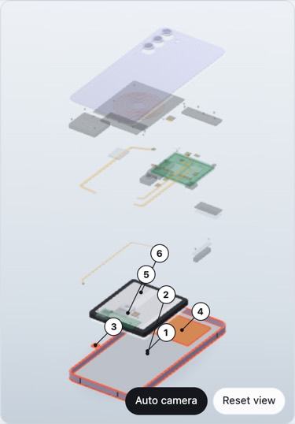 | 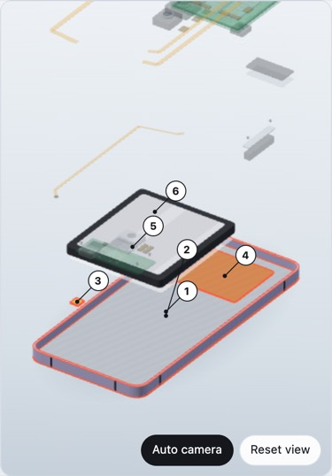 | 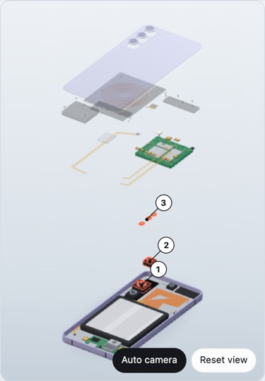 | 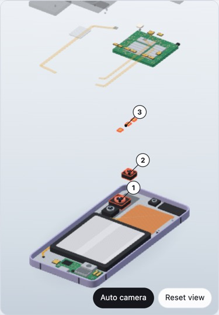 |

휴대폰 폭에서도 조립 중인 기기와 번호표가 커졌습니다. 오른쪽 아래 **자동 카메라·처음 시점** 버튼이 기기 모서리를 조금 가립니다. 이전에도 같은 위치에서 가렸으며, 이번에는 고치지 않았습니다.

## 검사

| 검사 | 결과 |
|---|---|
| Unfold 단위 테스트 | 49/49 (신규 3: 단계 상자 포함, 전환 연속성, 실제 타임라인 연동) |
| Gate 1 (5개 기기) | 모두 PASS, 0 오류 / 0 경고 (모델 데이터는 바꾸지 않음) |
| Gate 2 | S24 53/53 · 아이폰17 Pro 53/53 · Duo 58/58 · 폴드8 58/58 · 플립8 58/58 |
| 품질 검사 (5개 기기 × 375/768/1440) | 75개 상태 PASS |
| 16개 데모 5개 언어 × 3폭 | 240/240, 문제 0 |
| 카메라 연속성 (0.1 간격 전체 훑기) | 화면 위치 최대 이동 9.5px(S24, 분해 장면이며 이전 10.1px와 같은 수준). 폴더블의 38px는 시작부 접힘 동작으로, 이전 페이지도 같음 |

Gate 2 화면 대부분(`auto=0`)은 전체 범위 구도라서 이번 변경의 영향을 받지 않습니다. 기본 자동 카메라로 찍는 화면(이야기 장면, 각도, 휴대폰 폭)도 모두 통과했습니다.

## 재생 성능 (헤드리스 Chrome, AMD Radeon Pro 5300, DPR 2, 10초 재생, `t=8`부터)

| 측정 | 중앙값 | p95 | 50ms 초과 |
|---|---:|---:|---:|
| S24 1440 이후 / 이전 | 16.7 / 16.7ms | 16.8 / 16.7ms | 0 / 0 |
| 폴드8 1440 | 16.7ms | 16.8ms | 0 (최대 50ms) |
| 플립8 375 휴대폰 에뮬레이션 | 16.7ms | 16.7ms | 0 |

60Hz 상한 측정이라 프레임 누락은 보여 주지만 GPU 여유는 보여 주지 않습니다. 실제 휴대폰, 발열, 콜드 로드는 미검증입니다.

## 비용

이번 작업은 Fable 5.2를 호출하지 않았습니다(추가 비용 $0). 세션 누적은 그대로 $6.283400(정가 환산)입니다.
